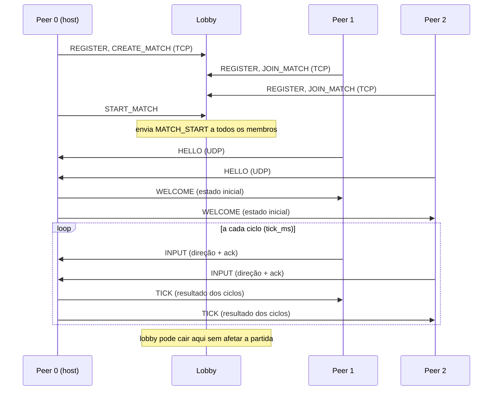
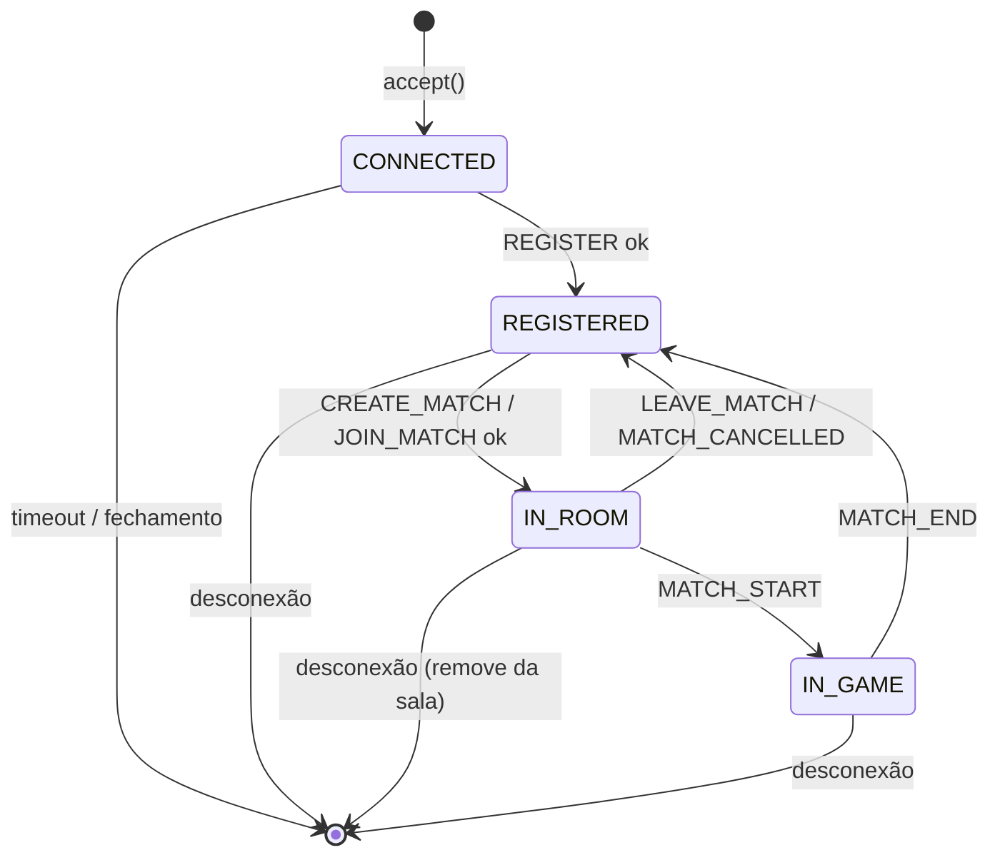
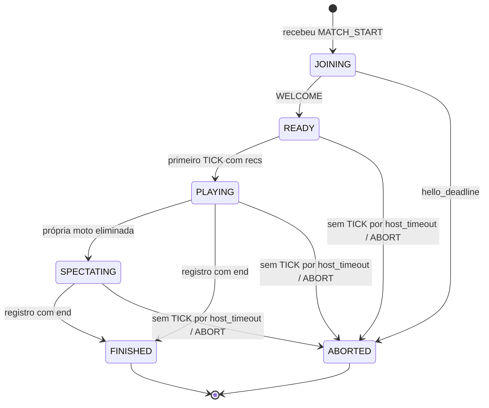
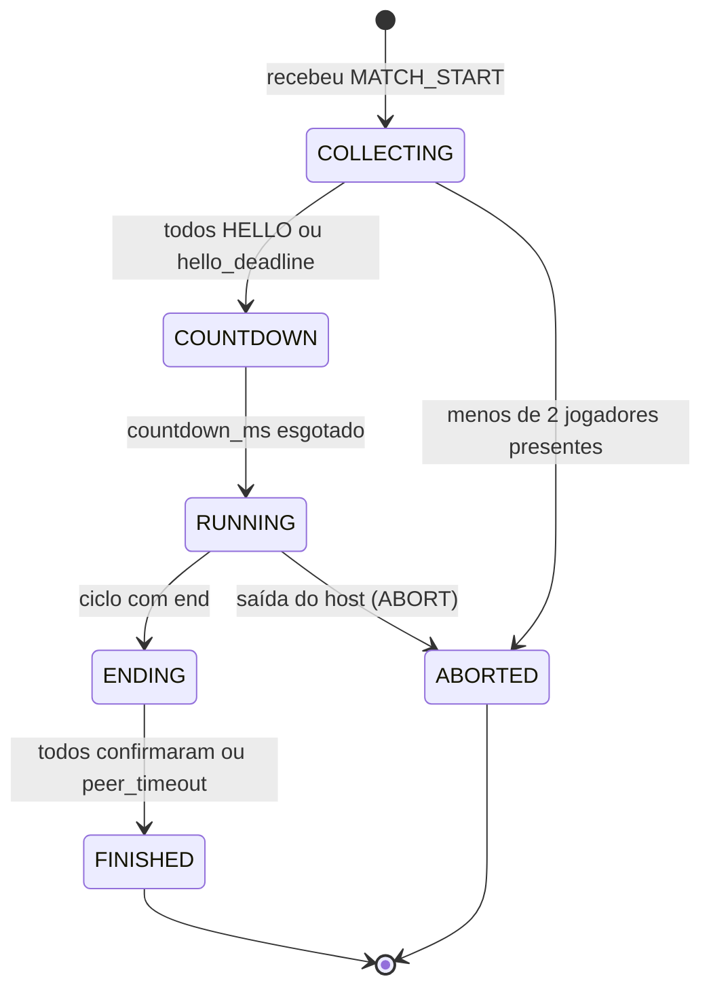

# DualNode

Jogo multijogador de **motos de luz em tempo real (estilo Tron)** com arquitetura híbrida: um **servidor de lobby (TCP)** para descoberta de jogadores e **comunicação direta entre os pares (UDP)** durante a partida.

Trabalho prático de Redes de Computadores: projeto e implementação de um protocolo de camada de aplicação.

- **Jogo:** Opção 1, Motos de Luz (Tron)
- **Linguagem:** Python 3.10+ (somente API de sockets da biblioteca padrão para a rede)
- **Transporte:** TCP (jogador ↔ lobby) e UDP (jogador ↔ jogador)
- **Jogadores por partida:** 3 a 4, cada um em um processo separado

---

## Sumário

1. [Visão geral](#1-visão-geral)
2. [Arquitetura](#2-arquitetura)
3. [Estrutura do projeto](#3-estrutura-do-projeto)
4. [Requisitos e instalação](#4-requisitos-e-instalação)
5. [Configuração](#5-configuração)
6. [Como executar](#6-como-executar)
7. [Como jogar](#7-como-jogar)
8. [Regras e simulação do jogo](#8-regras-e-simulação-do-jogo)
9. [Protocolo de aplicação: Lobby (TCP)](#9-protocolo-de-aplicação-lobby-tcp)
10. [Protocolo de aplicação: Partida (UDP)](#10-protocolo-de-aplicação-partida-udp)
11. [Máquinas de estados](#11-máquinas-de-estados)
12. [Mensagens inválidas, inesperadas ou ausentes](#12-mensagens-inválidas-inesperadas-ou-ausentes)
13. [Escolha do protocolo de transporte](#13-escolha-do-protocolo-de-transporte)
14. [Consistência de estado](#14-consistência-de-estado)
15. [Tolerância a falhas](#15-tolerância-a-falhas)
16. [Cenários de teste](#16-cenários-de-teste)
17. [Decisões de projeto e limitações](#17-decisões-de-projeto-e-limitações)
18. [Equipe](#18-equipe)

---

## 1. Visão geral

Cada jogador controla uma moto que anda uma célula por ciclo e deixa um rastro permanente. A única ação possível é mudar de direção (sem inverter o sentido). Perde quem bater em rastro, parede ou outra moto. Vence o último vivo; se os últimos vivos caírem no mesmo ciclo, é empate.

O sistema tem dois tipos de processo:

| Componente | Função |
|------------|--------|
| **Lobby** | Registra jogadores, cria/lista partidas e entrega a cada participante os endereços dos demais. **Não participa da partida.** |
| **Jogador (peer)** | Conecta ao lobby, cria ou entra em uma partida e, ao iniciá-la, troca mensagens UDP diretamente com os outros jogadores. |

Dentro de uma partida, o jogador que a criou atua como **host (árbitro)**: ele é o único que decide o resultado de cada ciclo. Os demais enviam suas direções e aplicam, em ordem, os resultados que o host publica (ver [seção 14](#14-consistência-de-estado)).

## 2. Arquitetura

```
                    ┌────────────────┐
        TCP         │     LOBBY      │         TCP
   ┌────────────────┤ (só descoberta)├────────────────┐
   │                └───────┬────────┘                │
   │                        │ TCP                     │
┌──▼───────┐         ┌──────▼───┐              ┌──────▼───┐
│ Peer 0   │◄──UDP──►│ Peer 1   │              │ Peer 2   │   (+ Peer 3 opcional)
│ (HOST)   │◄────────┴──────────┴──── UDP ─────►│          │
└──────────┘      INPUT ──► host    TICK ──► todos
```

Fluxo de uma partida:



Depois do `MATCH_START`, **nenhuma mensagem de jogo passa pelo lobby**. A conexão TCP com o lobby é mantida apenas para avisar o fim da partida e voltar ao menu; se o lobby cair, os jogadores apenas registram o fato em log e seguem jogando.

## 3. Estrutura do projeto

`[AJUSTAR]` Estrutura planejada:

```
DualNode/
├── lobby/
│   └── server.py          # servidor de lobby (TCP)
├── peer/
│   ├── main.py            # ponto de entrada do jogador
│   ├── lobby_client.py    # conversa com o lobby (TCP)
│   ├── host.py            # papel de host/árbitro (UDP)
│   ├── client.py          # papel de jogador comum (UDP)
│   └── ui.py              # interface em terminal
├── common/
│   ├── protocol.py        # codificação/validação das mensagens
│   ├── game_logic.py      # regras do jogo (ciclo determinístico)
│   └── config.py          # leitura de configuração
├── docs/
├── logs/                  # gerado em execução
├── config.example.json
├── requirements.txt
└── README.md
```

## 4. Requisitos e instalação

- Python 3.10 ou superior.
- Rede: processos em máquinas diferentes da mesma rede local. Liberar no firewall a porta TCP do lobby e as portas UDP dos jogadores.
- Bibliotecas: apenas a biblioteca padrão (`socket`, `selectors`/`threading`, `json`, `logging`, `curses`). Em Windows, a interface de terminal usa `pip install windows-curses`.

```bash
python -m venv .venv
source .venv/bin/activate          # Windows: .venv\Scripts\activate
pip install -r requirements.txt    # [AJUSTAR] (pode conter apenas windows-curses)
```

## 5. Configuração

Endereços e portas **não ficam no código**: vêm de um arquivo JSON e podem ser sobrescritos por argumentos de linha de comando.

`config.example.json`:

```json
{
  "lobby": {
    "host": "192.168.0.10",
    "port": 5000,
    "game": { "width": 40, "height": 20, "tick_ms": 100 }
  },
  "peer": {
    "bind_host": "0.0.0.0",
    "advertise_host": null,
    "udp_port": 6001
  },
  "timeouts": {
    "peer_timeout_ms": 3000,
    "host_timeout_ms": 3000,
    "hello_retry_ms": 500,
    "hello_deadline_ms": 10000,
    "lobby_ping_ms": 5000,
    "lobby_dead_ms": 15000
  }
}
```

| Parâmetro | Descrição |
|-----------|-----------|
| `lobby.host` / `lobby.port` | Onde o lobby escuta (lobby) ou onde os jogadores o encontram (peer). |
| `lobby.game.*` | Arena e velocidade. **Definidos pelo lobby** e entregues a todos no `MATCH_START`, garantindo que todos usem os mesmos valores. |
| `peer.bind_host` | Interface em que o jogador escuta UDP. |
| `peer.advertise_host` | IP que o jogador informa aos outros. Se `null`, o lobby usa o IP de origem da conexão TCP. |
| `peer.udp_port` | Porta UDP do jogador. |
| `timeouts.*` | Prazos de detecção de falha (ver [seção 15](#15-tolerância-a-falhas)). |

## 6. Como executar

`[AJUSTAR]` Comandos propostos:

**1. Lobby** (na máquina do servidor):

```bash
python -m lobby.server --config config.json
# ou: python -m lobby.server --host 0.0.0.0 --port 5000
```

**2. Jogadores** (um processo por jogador, na mesma máquina em portas distintas ou em máquinas diferentes):

```bash
python -m peer.main --config config.json --name Alice --udp-port 6001
python -m peer.main --config config.json --name Bob   --udp-port 6002
python -m peer.main --config config.json --name Carol --udp-port 6003
# sobrescrevendo o lobby: --lobby-host 192.168.0.10 --lobby-port 5000
```

**3. Criar e iniciar a partida:**

1. Alice escolhe *Criar partida* (informa 3 ou 4 jogadores). Ela vira o host.
2. Bob e Carol escolhem *Listar partidas* e *Entrar*.
3. Quando houver pelo menos 3 jogadores, Alice escolhe *Iniciar*.
4. Contagem regressiva e início.

**Opções de depuração** (para os testes da seção 16): `--sim-loss 0.2` (descarta 20% dos datagramas UDP recebidos), `--sim-delay-ms 80` (atraso artificial) e `--log-level DEBUG`. Logs em `logs/`.

## 7. Como jogar

| Tecla | Ação |
|-------|------|
| `W` / `↑` | Cima |
| `S` / `↓` | Baixo |
| `A` / `←` | Esquerda |
| `D` / `→` | Direita |
| `Q` | Sair da partida |

A moto de cada jogador aparece com um símbolo/cor próprio (`0`–`3`); rastros permanecem na tela mesmo após a eliminação. Jogadores eliminados continuam assistindo até o fim da partida.

## 8. Regras e simulação do jogo

**Arena:** grade de `width × height` (padrão 40 × 20). Coordenadas `(x, y)` com `x` crescendo para a direita e `y` crescendo para baixo. Direções: `U` (y−1), `D` (y+1), `L` (x−1), `R` (x+1).

**Ciclo:** a cada `tick_ms` (padrão 100 ms, 10 ciclos/s), todas as motos vivas avançam exatamente uma célula.

**Posições iniciais** (o `pid` é o *slot* atribuído pelo lobby, 0 a 3; o host é sempre o `pid` 0):

| pid | Posição inicial | Direção |
|-----|-----------------|---------|
| 0 | (5, 5) | R |
| 1 | (34, 14) | L |
| 2 | (20, 1) | D |
| 3 | (20, 18) | U |

A célula inicial de cada moto já conta como rastro.

**Algoritmo do ciclo (normativo, executado só pelo host).** Todas as decisões usam o estado do *início* do ciclo, portanto não dependem da ordem dos jogadores:

1. **Direções.** Para cada moto viva, toma-se a última direção desejada recebida (`INPUT` válido mais recente). Se for o sentido oposto ao movimento atual, é ignorada e a moto mantém a direção. Caso contrário, passa a ser a direção atual. Se não houver `INPUT`, mantém a direção.
2. **Alvo.** Cada moto viva calcula `alvo = posição + direção`.
3. **Eliminações** (avaliadas nesta ordem para cada moto; vale a primeira que ocorrer):
   - `WALL`: o alvo está fora da arena.
   - `TRAIL`: o alvo está ocupado por qualquer rastro (de motos vivas ou eliminadas, e inclui a célula atual de cada moto, o que também elimina trocas de posição frente a frente).
   - `HEAD`: duas ou mais motos têm o mesmo alvo; **todas** são eliminadas.
   - `DISC`: desconexão detectada (ver seção 15), aplicada antes de calcular o movimento do ciclo.
4. **Movimento.** As motos que sobreviveram entram no alvo e a célula passa a ser rastro. Motos eliminadas **não avançam**; seus rastros anteriores permanecem.
5. **Fim.** Se restarem 1 moto viva, ela vence (`WIN`). Se restarem 0 (as últimas foram eliminadas no mesmo ciclo), é `DRAW`.

O resultado do ciclo é publicado como um **registro de ciclo** (campo `recs` da mensagem `TICK`, seção 10).

## 9. Protocolo de aplicação: Lobby (TCP)

**Enquadramento:** cada mensagem é um objeto JSON em UTF-8 terminado por `\n` (uma mensagem por linha). Tamanho máximo de linha: 4096 bytes (excedeu → conexão encerrada). Todo objeto tem `"v": 1` (versão) e `"t"` (tipo).

### Jogador → Lobby

| Tipo | Campos | Significado |
|------|--------|-------------|
| `REGISTER` | `name` (1–16 chars `[A-Za-z0-9_-]`), `udp_port` (1024–65535), `udp_host` (opcional) | Registra o jogador. Se `udp_host` faltar, o lobby usa o IP de origem da conexão TCP. |
| `CREATE_MATCH` | `name` (nome da sala), `max_players` (3 ou 4) | Cria partida; o criador é o host (slot 0). |
| `LIST_MATCHES` | (nenhum) | Pede as partidas abertas. |
| `JOIN_MATCH` | `match_id` | Entra em uma partida aberta. |
| `LEAVE_MATCH` | (nenhum) | Sai da partida em que está (antes de iniciar). |
| `START_MATCH` | (nenhum) | Só o criador. Exige ≥ 3 jogadores. |
| `MATCH_END` | `winner` (pid ou `null` em empate) | Host informa o fim da partida (opcional, melhor esforço). |
| `PING` / `PONG` | (nenhum) | Verificação de vida, nos dois sentidos. |

### Lobby → Jogador

| Tipo | Campos | Significado |
|------|--------|-------------|
| `REGISTER_OK` | `player_id` | Registro aceito. |
| `MATCH_CREATED` | `match_id`, `slot` | Partida criada. |
| `MATCH_LIST` | `matches`: lista de `{match_id, name, host_name, players, max_players}` | Partidas abertas. |
| `JOIN_OK` | `match_id`, `slot`, `players`: lista de `{slot, name}` | Entrada confirmada. |
| `PLAYER_JOINED` / `PLAYER_LEFT` | `slot`, `name` | Mudança na sala em que o jogador está. |
| `MATCH_CANCELLED` | `reason` | Partida cancelada (ex.: criador saiu antes do início). |
| `MATCH_START` | `match_id`, `host_slot` (=0), `config` `{width, height, tick_ms}`, `players`: lista de `{slot, name, host, port}` | Início. Contém tudo o necessário para a fase UDP. |
| `ERROR` | `code`, `msg` | Falha ao processar a requisição. |

**Códigos de `ERROR`:** `BAD_FORMAT`, `UNKNOWN_TYPE`, `BAD_STATE`, `INVALID_PARAM`, `NAME_TAKEN`, `MATCH_NOT_FOUND`, `MATCH_FULL`, `MATCH_STARTED`, `NOT_CREATOR`, `NOT_ENOUGH_PLAYERS`.

Exemplo de `MATCH_START`:

```json
{"v":1,"t":"MATCH_START","match_id":"m7","host_slot":0,
 "config":{"width":40,"height":20,"tick_ms":100},
 "players":[{"slot":0,"name":"Alice","host":"192.168.0.21","port":6001},
            {"slot":1,"name":"Bob","host":"192.168.0.22","port":6002},
            {"slot":2,"name":"Carol","host":"192.168.0.23","port":6003}]}
```

## 10. Protocolo de aplicação: Partida (UDP)

**Formato:** um objeto JSON UTF-8 por datagrama, no máximo **1200 bytes** (evita fragmentação IP). Campos comuns: `v` (versão, 1), `t` (tipo), `m` (`match_id`), `pid` (slot do remetente). Todo datagrama é validado antes de ser processado (seção 12).

### Mensagens

| Tipo | Sentido | Campos | Significado |
|------|---------|--------|-------------|
| `HELLO` | peer → host | `pid` | "Estou pronto." Reenviado a cada `hello_retry_ms` até chegar `WELCOME`. |
| `WELCOME` | host → peer | `state`: `{width, height, tick_ms, players:[{pid,x,y,dir}]}`, `countdown_ms` | Estado inicial. Idempotente: respondido a cada `HELLO` recebido. |
| `INPUT` | peer → host | `pid`, `iseq` (inteiro crescente), `dir` (`U`/`D`/`L`/`R`), `ack` (último ciclo aplicado, 0 se nenhum) | Direção desejada, **enviada em todo ciclo**, mesmo sem mudança. Serve como comando, confirmação e sinal de vida. |
| `TICK` | host → peer | `recs`: lista de registros de ciclo (consecutivos, no máximo 8) | Resultados dos ciclos. Enviado a cada ciclo para todos, mesmo com `recs` vazio (sinal de vida durante a contagem). |
| `ABORT` | host → peers | `reason` | Host encerra a partida de forma controlada (melhor esforço; os peers também detectam por timeout). |

**Registro de ciclo** (elemento de `recs`):

```json
{"n": 42,
 "mv": [[0,17,5],[1,22,14]],
 "el": [[2,"TRAIL"],[3,"HEAD"]],
 "end": null}
```

| Campo | Significado |
|-------|-------------|
| `n` | Número do ciclo (começa em 1, estritamente consecutivo). |
| `mv` | Novas posições `[pid, x, y]` das motos que se moveram neste ciclo. |
| `el` | Eliminações `[pid, motivo]`; motivo ∈ `WALL`, `TRAIL`, `HEAD`, `DISC`. |
| `end` | `null`, ou `{"result":"WIN","winner":pid}`, ou `{"result":"DRAW"}`. |

### Confiabilidade sobre UDP (garantias implementadas na aplicação)

O UDP não garante entrega, ordem nem ausência de duplicatas. O protocolo resolve isso sem retransmissão por temporizador:

1. **Ordem e duplicatas:** cada registro tem um `n` consecutivo. O peer aplica **apenas** o registro `n = último_aplicado + 1`; registros com `n` menor ou igual são descartados (duplicata) e com `n` maior são ignorados até o anterior chegar.
2. **Recuperação de perdas (confirmação cumulativa + redundância):** todo `INPUT` carrega `ack`. A cada ciclo, o host envia a cada peer os registros de `ack + 1` até `min(ciclo_atual, ack + 8)`. Assim, se um `TICK` se perde, o seguinte já repete os registros que faltam, e um peer atrasado se atualiza até 8 ciclos por datagrama.
3. **Entrada idempotente:** o `INPUT` é estado ("a direção desejada é X"), não evento. A perda de um `INPUT` é compensada pelo seguinte; o host usa o de maior `iseq` (reordenados/antigos são descartados).
4. **Handshake:** `HELLO` é reenviado até chegar `WELCOME`; `WELCOME` é reenviado a cada `HELLO` repetido.
5. **Fim confiável:** após o registro com `end`, o host continua enviando-o até todos os peers vivos confirmarem (`ack` ≥ `n` final) ou até `peer_timeout_ms`. Os peers continuam enviando `INPUT` por até 2 s após o fim para confirmar.
6. **Detecção de vida:** `INPUT` (peer → host) e `TICK` (host → peer) são enviados a todo ciclo e funcionam como *heartbeat*.

## 11. Máquinas de estados

### Sessão com o lobby (lado do lobby, por conexão TCP)



| Estado | Mensagens aceitas | Qualquer outra |
|--------|-------------------|----------------|
| `CONNECTED` | `REGISTER`, `PONG` | `ERROR BAD_STATE` |
| `REGISTERED` | `LIST_MATCHES`, `CREATE_MATCH`, `JOIN_MATCH`, `PONG` | `ERROR BAD_STATE` |
| `IN_ROOM` | `LEAVE_MATCH`, `START_MATCH` (criador), `LIST_MATCHES`, `PONG` | `ERROR BAD_STATE` |
| `IN_GAME` | `MATCH_END` (host), `PONG` | ignorada |

### Jogador comum (peer ≠ host) durante a partida



### Host durante a partida



- `COLLECTING`: responde `HELLO` com `WELCOME`. Quem não enviar `HELLO` até `hello_deadline_ms` é tratado como desconectado e eliminado (`DISC`) no ciclo 1.
- `COUNTDOWN`: envia `TICK` vazios (sinal de vida) enquanto aguarda `countdown_ms`.
- `RUNNING`: a cada `tick_ms`, aplica o algoritmo da seção 8, grava o registro no histórico e envia `TICK` a cada peer.

## 12. Mensagens inválidas, inesperadas ou ausentes

### UDP (partida)

| Situação | Tratamento |
|----------|------------|
| JSON malformado, campo obrigatório ausente ou com tipo errado | Descartar silenciosamente e registrar em log. |
| `v` diferente de 1, `t` desconhecido | Descartar. |
| `m` diferente do `match_id` da partida | Descartar. |
| Endereço de origem não corresponde ao `host:port` do `pid` informado no `MATCH_START` | Descartar (evita falsificação simples e interferência de terceiros). |
| `dir` inválida | Descartar o `INPUT`. |
| `INPUT` com `iseq` ≤ ao já visto | Descartar (duplicado/atrasado). |
| Direção oposta ao movimento atual | Ignorada pelo host; a moto mantém a direção. |
| `INPUT` de peer já eliminado ou desconectado | Usado só para `ack`/vida; a direção é ignorada. |
| `TICK` de endereço que não é o host | Descartar. |
| `TICK` com `n` repetido ou fora de ordem | Repetido: descartar. Futuro: ignorar até receber o anterior. |
| `HELLO` repetido | Reenviar `WELCOME` (idempotente). |
| `HELLO`/`INPUT` fora de estado | Descartar. |
| Datagrama maior que 1200 bytes | Descartar. |
| **Ausência** de `INPUT` de um peer por `peer_timeout_ms` | Host elimina a moto com `DISC`. |
| **Ausência** de `TICK` por `host_timeout_ms` | Peer encerra a partida (`HOST_LOST`). |

Nunca se responde com erro a UDP inválido: isso evitaria amplificação e *loops* entre implementações.

### TCP (lobby)

| Situação | Tratamento |
|----------|------------|
| Linha que não é JSON válido | `ERROR BAD_FORMAT`; após 3 consecutivas, fecha a conexão. |
| `t` desconhecido | `ERROR UNKNOWN_TYPE`. |
| Mensagem válida no estado errado | `ERROR BAD_STATE`, sem alterar o estado. |
| Parâmetro fora da faixa (ex.: `max_players = 7`) | `ERROR INVALID_PARAM`. |
| Linha maior que 4096 bytes | Fecha a conexão. |
| Cliente sem responder `PING` por `lobby_dead_ms` | Lobby fecha e remove o jogador (se estava em sala, notifica com `PLAYER_LEFT`). |
| Lobby sem resposta a uma requisição (jogador) | Jogador reexibe o menu e permite tentar de novo; após `lobby_dead_ms` sem nenhum dado, considera o lobby indisponível. |

## 13. Escolha do protocolo de transporte

**Lobby: TCP.** O tráfego é esporádico (registro, listar, entrar), exige entrega e ordem (não faz sentido perder um `JOIN_MATCH` ou receber `MATCH_START` antes do `PLAYER_JOINED`) e o fechamento da conexão é um indicador natural de que o jogador saiu. O custo extra do TCP é irrelevante nessa frequência.

**Partida: UDP.** O jogo é de tempo real e gera um fluxo contínuo de mensagens pequenas (10 ciclos/s). Em um jogo assim, o dado mais novo importa mais que o antigo:

- No TCP, a perda de um segmento bloqueia a entrega de tudo o que chegou depois (*head-of-line blocking*) até a retransmissão, o que congelaria a partida de todos justamente por um dado que já está obsoleto.
- Aqui o protocolo já é naturalmente tolerante a perdas: o `INPUT` é estado e o `TICK` repete registros pendentes. Portanto, o UDP basta, e a confiabilidade necessária (ordem, duplicatas, recuperação) é implementada na aplicação de forma simples (seção 10), sem pagar o bloqueio do TCP.
- Menos conexões: com 4 jogadores em malha de TCP seriam 6 conexões a estabelecer e monitorar; com UDP basta um socket por processo.

**Custo/limitação assumida:** a lógica de confiabilidade fica no código do grupo. Sem *congestion control*, o que é aceitável nessa escala (4 jogadores, pacotes < 1200 bytes, poucas dezenas de datagramas/s).

## 14. Consistência de estado

**Requisito:** todos os jogadores devem chegar ao mesmo resultado (quais motos colidiram, em que ciclo e quem venceu).

**Decisão:** o **host é a única autoridade do estado**. Só ele executa o algoritmo da seção 8. Os outros jogadores não simulam colisões: apenas enviam suas direções e aplicam, **na ordem dos ciclos**, os registros publicados. Como todos aplicam a mesma sequência de registros (garantida por `n` consecutivo e pela recuperação de perdas), não há como divergirem.

**Por que não simulação distribuída (lockstep) em que cada par calcula o estado?**

| | Host autoritativo (escolhido) | Lockstep (todos simulam) |
|---|---|---|
| Consistência | Garantida por construção | Exige que todos recebam todas as entradas de cada ciclo |
| Atraso | O jogo anda no ritmo do host; atraso de um peer não trava os demais | O ciclo só avança quando a entrada do mais lento chega (ou exige regra de timeout que todos precisam aplicar igual) |
| Desconexão | O host decide e publica um único `DISC` | Todos precisam **concordar** sobre em qual ciclo o jogador saiu |
| Complexidade | Baixa | Alta |
| Ponto único de falha | Sim (o host) | Não |

O ponto único de falha é aceito pelo enunciado, desde que a falha do host encerre a partida de forma controlada (seção 15). A principal desvantagem é a **latência**: a direção de um peer leva até meio RTT para chegar ao host e o resultado leva outro meio RTT para voltar. Em LAN isso é inferior a 1 ciclo (100 ms). O host joga com atraso zero, uma vantagem conhecida e documentada.

## 15. Tolerância a falhas

| Falha | Detecção | Comportamento |
|-------|----------|---------------|
| **Lobby cai antes do início** | Jogador: erro de TCP ou sem `PING` por `lobby_dead_ms` | Jogador informa que o lobby está indisponível; partidas ainda não iniciadas não prosseguem. |
| **Lobby cai durante a partida** | Jogador: erro na conexão TCP | Registra em log e **segue jogando**. A partida não depende mais do lobby; só o aviso de fim (`MATCH_END`) deixa de ser enviado. |
| **Peer comum cai** (processo morto, rede) | Host: sem `INPUT` por `peer_timeout_ms` (3 s) | Host elimina a moto com motivo `DISC` no próximo ciclo; o rastro permanece e a partida continua. Se sobrar só 1 viva, ela vence. |
| **Peer cai antes de o jogo começar** | Host: sem `HELLO` por `hello_deadline_ms` | Eliminado (`DISC`) no ciclo 1. Se restar menos de 2 jogadores, `ABORT`. |
| **Host cai** | Peers: sem `TICK` por `host_timeout_ms` (3 s) | Cada peer encerra a partida de forma **controlada** (`HOST_LOST`): mostra mensagem, para de enviar e volta ao menu. Não há eleição de novo host. |
| **Host encerra voluntariamente** (`Q`/Ctrl+C) | Peers: `ABORT` ou timeout | Mesmo tratamento da queda do host. |
| **Perda de pacotes UDP** | `ack` atrasado no host | Recuperação automática pela redundância dos `TICK`. |
| **Peer lento** (mas vivo) | `ack` atrasando | Recebe até 8 ciclos por datagrama para se atualizar. Se parar de enviar `INPUT` por 3 s, é tratado como desconectado. |

Nenhum jogador fica travado indefinidamente: todo estado de espera tem um prazo (`hello_deadline_ms`, `peer_timeout_ms`, `host_timeout_ms`).

## 16. Cenários de teste

Registrar logs/capturas de cada cenário no relatório técnico.

| # | Cenário | Como reproduzir | Resultado esperado |
|---|---------|-----------------|--------------------|
| 1 | **Partida completa** (3 e 4 jogadores) | Lobby + 3 ou 4 jogadores; criar, entrar, iniciar e jogar até o fim | Todos exibem o mesmo ciclo de cada eliminação e o mesmo vencedor |
| 2 | **Colisão frontal / mesmo ciclo** | Dois jogadores direcionados à mesma célula | Ambos `HEAD` no mesmo `n`; todos concordam |
| 3 | **Empate** | Últimos vivos eliminados no mesmo ciclo | `end: DRAW` em todos |
| 4 | **Desconexão de peer** | `kill -9` em um jogador no meio da partida | Após ~3 s o host publica `DISC`; os demais continuam |
| 5 | **Falha do lobby** | Encerrar o lobby com a partida em andamento | A partida segue até o fim sem interrupção |
| 6 | **Falha do host** | Encerrar o host (jogador 0) | Em ~3 s os demais encerram a partida de forma controlada |
| 7 | **Perda de pacotes** | `--sim-loss 0.2` (e/ou `--sim-delay-ms 80`) nos peers | Jogo segue e todos terminam com o mesmo resultado |
| 8 | **Mensagens inválidas** | Enviar datagramas/linhas malformados (ex.: `echo '{"x":1}' \| nc -u host 6001`; `nc host 5000`) | UDP descartado; TCP responde `ERROR`; nada trava |
| 9 | **Máquinas diferentes** | Lobby e jogadores em máquinas distintas da mesma rede | Mesmo comportamento do cenário 1 |
| 10 | **Cancelamento na sala** | Criador sai antes de iniciar | `MATCH_CANCELLED` para os demais |

## 17. Decisões de projeto e limitações

**Decisões**

- Host autoritativo, determinístico e com algoritmo de ciclo independente da ordem dos jogadores (seção 8).
- `INPUT` como estado, `TICK` com redundância e ack cumulativo, em vez de retransmissão por temporizador (seção 10).
- JSON como formato de mensagem: legível para depuração e permitido pelo enunciado. Em contrapartida, ocupa mais bytes que um formato binário; ainda assim, os datagramas ficam bem abaixo de 1200 bytes.
- Configuração do jogo (arena, velocidade) centralizada no lobby e entregue em `MATCH_START`, para que todos os participantes usem valores idênticos.

**Limitações conhecidas**

- Se o host cair, a partida termina (sem eleição de novo host).
- O host tem latência zero em relação aos demais.
- Sem autenticação nem proteção contra um host malicioso; a validação de origem por `host:port` protege apenas contra interferência acidental.
- Se um peer trocar de direção duas vezes dentro do mesmo ciclo, só a última direção válida é considerada.
- Sem suporte a NAT/Internet; o alvo é uma rede local.

**Principais dificuldades encontradas:** ``

## 18. Equipe

| Nome | Matrícula | Responsabilidades |
|------|-----------|-------------------|
| wmatheus-xavier|252024622|
| |
| |
| |

---

*Projeto acadêmico. Entrega final em 23/11/2026; apresentações a partir de 24/11/2026.*
